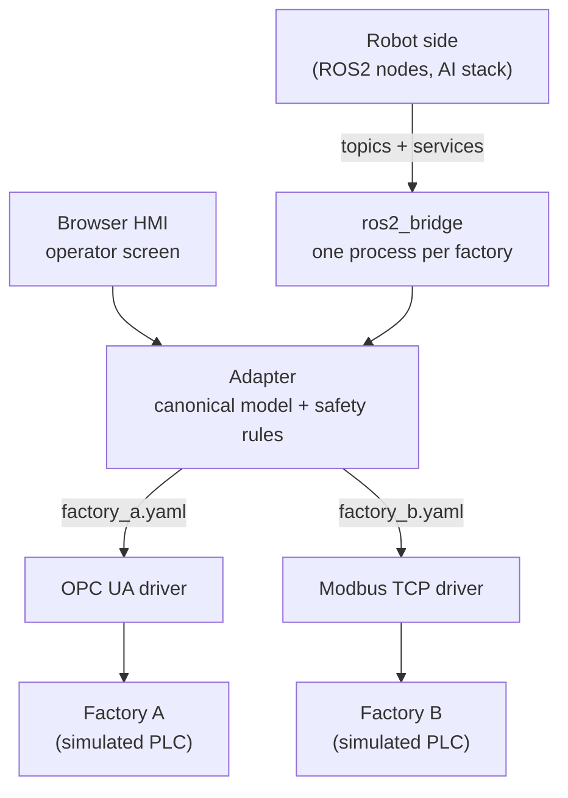
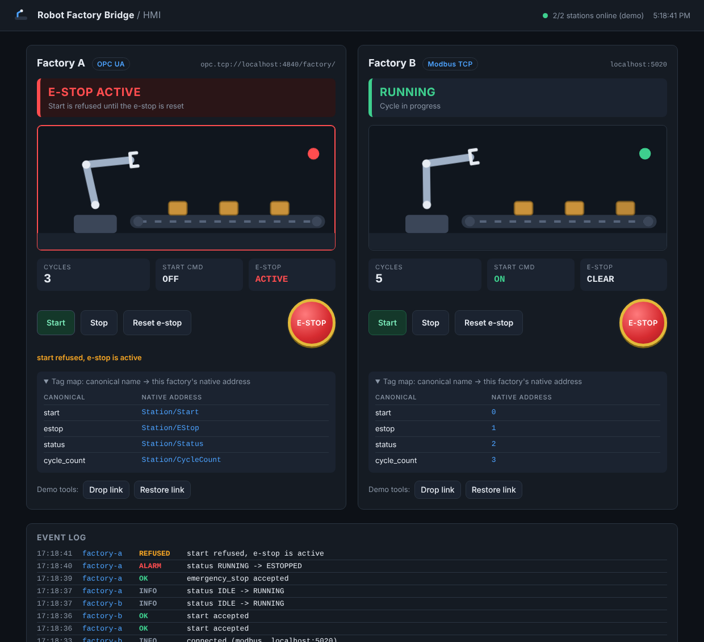
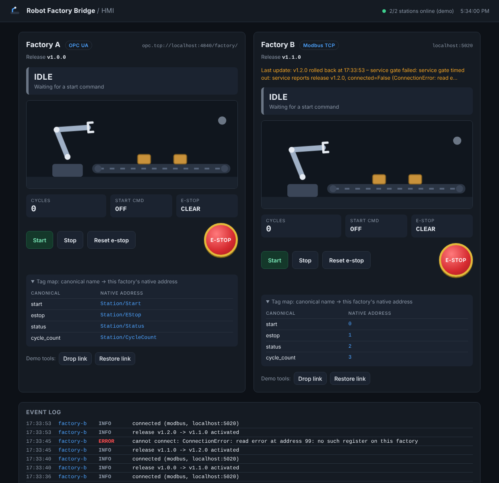

# Robot Factory Bridge

One adapter that connects a robot stack to **any factory's control system**, so a
new customer means a new config file, not a new custom build.

Two simulated factories speak different industrial protocols with different tag
layouts (OPC UA and Modbus TCP). A single adapter maps both onto one canonical
model, enforces a safety rule in the middle, a ROS2 bridge exposes the result
to the robot side, and a browser HMI lets an operator watch and drive both factories, and a release
flow updates a factory's config with checks and automatic rollback.



## Why this design

- **Protocols are plug-ins.** Drivers only move raw values. A new protocol is one
  class and one line in the registry (`adapter/drivers/`).
- **Factories are configuration.** A YAML file maps each canonical tag
  (`start`, `estop`, `status`, `cycle_count`) to that factory's native address, and
  can translate its status codes. A config that leaves a tag unmapped fails at
  load time, not on site.
- **Safety lives in one place.** `start()` is refused while the e-stop is active;
  `emergency_stop()` is always accepted and also drops the start command. Every
  factory and every interface (Python, ROS2) gets the same behaviour.
- **Refusals are answers, not crashes.** Over ROS2 a refused command returns
  `success: false` with a reason.

## Layout

```
adapter/          canonical model, config loader, drivers (opcua, modbus), safety rules
config/           one YAML per factory
sim/              simulated factories (OPC UA server, Modbus server) + smoke test
ros2_bridge/      ROS2 node: state as topics, commands as services
hmi/              browser HMI: live status, commands, event log (stdlib only)
ota/              release flow: verify, pre-flight, switch, confirm, roll back
releases/         example release bundles (one good, one broken on purpose)
config/docker/    the factory configs with container host names
tests/            54 tests (adapter logic, config validation, bridge helpers, HMI, releases)
docs/             factory layouts, ROS2 interface notes
demo.py           the same robot-side code driving both factories
```

## Quick start (Windows or Linux, no ROS needed)

Tested on Python 3.12 (Ubuntu) and 3.13 (Windows). Very new Python versions may lack
prebuilt wheels for some dependencies.

```
python -m venv .venv
.venv\Scripts\Activate.ps1          # Linux: source .venv/bin/activate
pip install -r requirements.txt
python -m pytest                    # 54 passed
```

Run the two simulated factories in two terminals, then the demo in a third:

```
python sim/opcua_server.py
python sim/modbus_server.py
python demo.py
```

`demo.py` runs one function against both factories: start, run, emergency stop,
refused restart, reset.

## HMI (browser)



```
python -m hmi.server --demo        # nothing else needed
python -m hmi.server               # against the two simulators
```

Open http://localhost:8080. Two cards show each factory's live state, an animated robot
cell, the tag map (same canonical tags, different native addresses) and an event log
that includes safety refusals and lost links. No extra packages. Details in
[docs/hmi.md](docs/hmi.md).

## Releases and rollback



A simulated over-the-air update: a release is a config bundle with a checksum. It must
pass a pre-flight against the factory, then the *running* HMI must confirm it, otherwise
the previous release is restored automatically.

```
python -m ota init
python -m hmi.server --demo --deploy deploy
python -m ota deploy releases/factory-b-v1.2.0 --service http://localhost:8080 --demo --skip-preflight
```

The last command ships a broken release past pre-flight: factory B goes COMMS LOST, the
deployer rolls back, and the card recovers. Details and all scenarios in
[docs/ota.md](docs/ota.md). `docker compose up --build` starts everything in containers.

## ROS2 bridge (Ubuntu 24.04, ROS2 Jazzy)

Developed on WSL2. Details in [docs/ros2_bridge.md](docs/ros2_bridge.md).

```
python sim/opcua_server.py                                            # terminal 1
python sim/modbus_server.py                                           # terminal 2
python -m ros2_bridge.factory_bridge --config config/factory_a.yaml   # terminal 3
python -m ros2_bridge.factory_bridge --config config/factory_b.yaml   # terminal 4
```

Then from any ROS2 shell:

```
ros2 topic echo /factory_a/status
ros2 service call /factory_a/start std_srvs/srv/Trigger
ros2 service call /factory_a/emergency_stop std_srvs/srv/Trigger
ros2 service call /factory_a/start std_srvs/srv/Trigger    # refused: e-stop is active
ros2 service call /factory_a/reset_estop std_srvs/srv/Trigger
```

The same commands work for `/factory_b/...`, which runs over Modbus.

## Testing

The adapter and the bridge helpers are tested against an in-memory fake driver, so the
suite needs no network, simulators or ROS2. The real OPC UA and Modbus drivers and the
ROS2 node are exercised end to end with the simulators (see above).

## Status and roadmap

Done: canonical model, OPC UA and Modbus drivers, YAML-driven factories, safety rules,
simulators, ROS2 bridge, browser HMI, release flow with rollback, Docker files, tests.

Planned:
- C++ `ros2_control` hardware interface for a simulated actuator
- MQTT as a third protocol and factory
- Run the Docker setup end to end and add signed bundles
- Fault injection and a diagnostic tool that classifies field issues
- Safety note mapping the interlock to ISO 13849 concepts

## Notes

- `pymodbus` is pinned to 3.8.x because its API changed in later releases.
- Everything here is generic and simulated.
