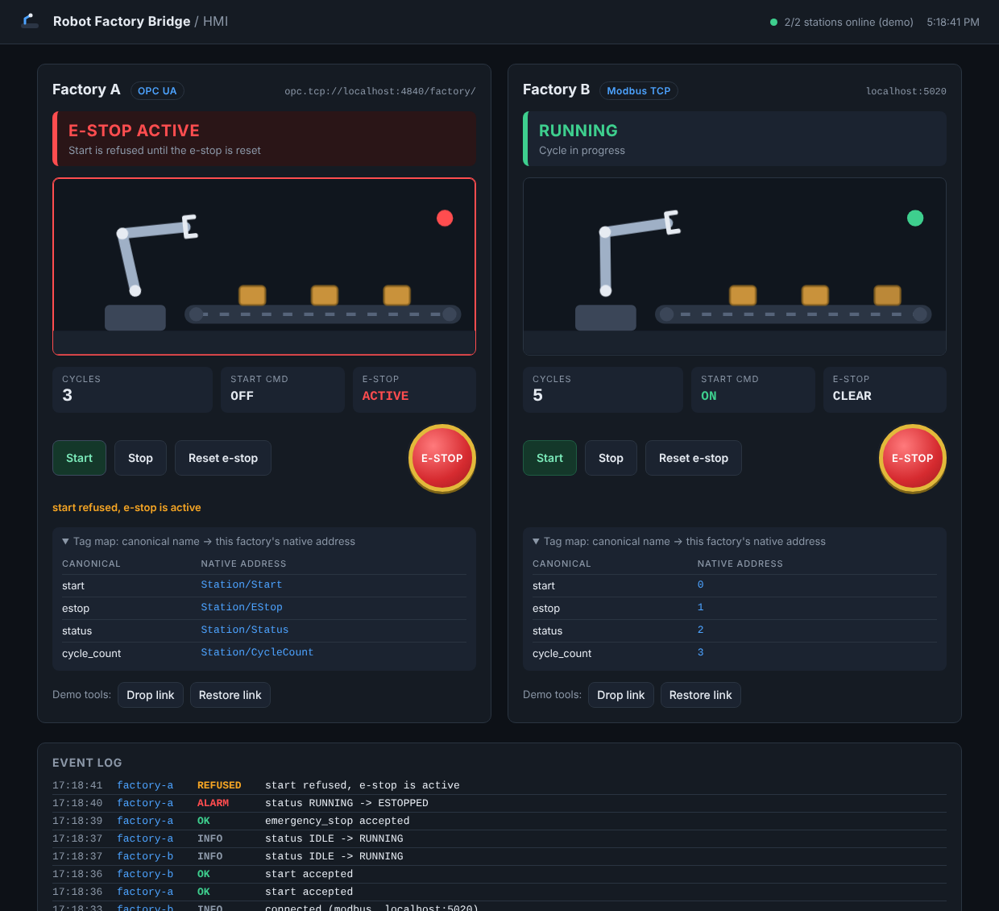

# Browser HMI

A live operator screen for the factories, in the browser. It is one more client of the
same adapter that the ROS2 bridge uses, so it speaks the canonical interface (`start`,
`estop`, `status`, `cycle_count`) and never mentions OPC UA or Modbus.



## Run

No extra packages. From the project folder, venv active:

```
python -m hmi.server --demo        # in-memory factories, nothing else needed
```

or against the real simulators (one terminal each):

```
python sim/opcua_server.py
python sim/modbus_server.py
python -m hmi.server
```

Open http://localhost:8080. Options: `--port`, `--config` (repeatable, one YAML per
factory), `--host` (default is local only).

## What it shows

- One card per factory: protocol, endpoint, live state, cycle counter, start and e-stop flags.
- An animated robot cell that runs only while the factory reports RUNNING, freezes on
  an e-stop, and greys out with COMMS LOST when the link drops.
- Start, Stop, Reset e-stop and a large E-STOP button.
- A **tag map** per card: the same canonical tags next to that factory's native
  addresses (`Station/Start` over OPC UA, register `0` over Modbus).
- An event log: commands, status changes, alarms, link losses and, importantly, safety
  refusals. Press Start while the e-stop is active and the card shakes, the refusal
  is logged, and nothing is written to the factory.

In `--demo` mode there are also "Drop link / Restore link" buttons to show the
reconnect behaviour.

## Design notes

- **Standard library only.** `http.server` plus one HTML file. The adapter is asyncio,
  so it runs on the same background-loop helper as the ROS2 bridge (`ros2_bridge/runner.py`).
- **One polling thread per factory.** A dead factory never slows the other one.
  The page reads cached state, so a slow factory cannot freeze the screen.
- **Failures are states, not crashes.** If a factory is down at startup or the link
  drops later, the card shows COMMS LOST, the HMI retries every 2 s and logs the outage
  once. When the factory returns, the card recovers by itself.
- **Safety stays in the adapter.** The HMI has no safety logic of its own. A refused
  start is an ordinary answer from the adapter, shown to the operator.
- **API:** `GET /api/state` and `POST /api/command` with `{"station": "factory_a",
  "command": "start"}` (commands: `start`, `stop`, `emergency_stop`, `reset_estop`).
  POST accepts only `application/json`, so another website cannot send commands to a
  local HMI from the browser. It listens on 127.0.0.1 by default.
- **Not a certified HMI.** The E-STOP button here is a software command through the
  adapter. A real e-stop is a hard-wired safety circuit.
