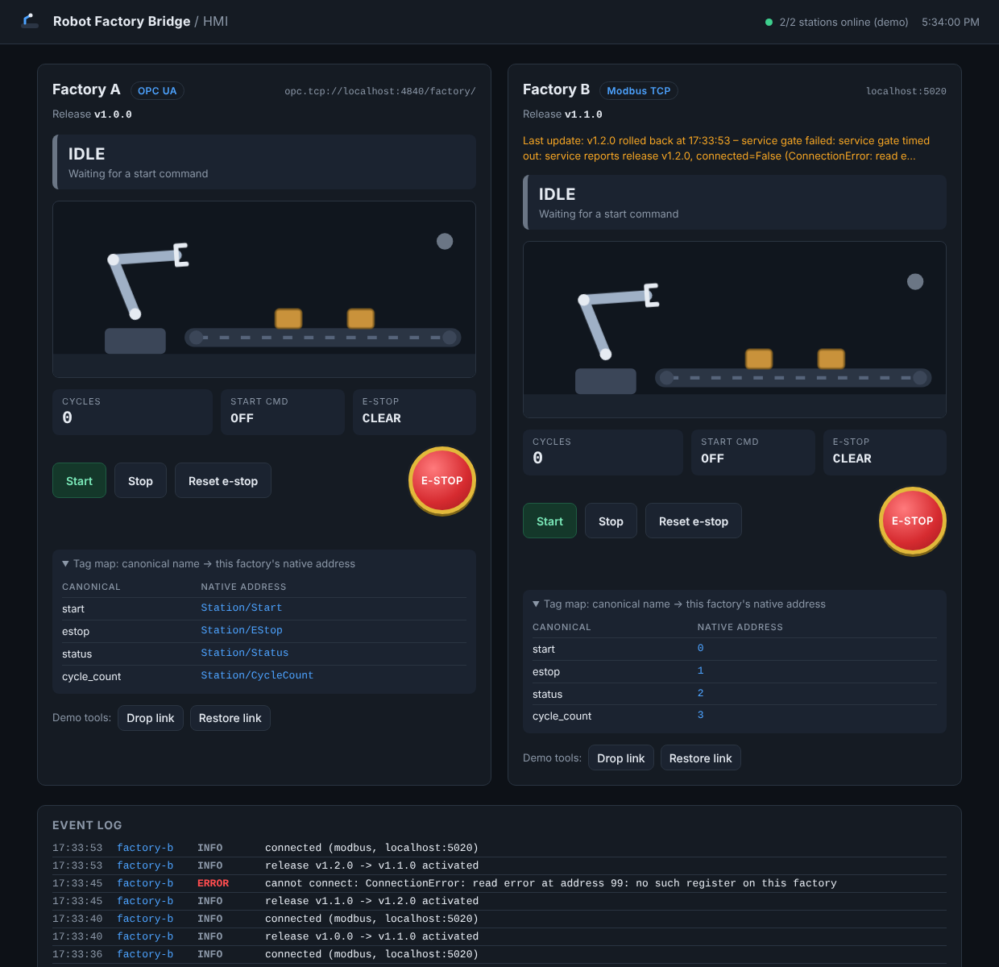

# Releases and rollback (simulated over-the-air update)

A factory's config is delivered as a **release**: a bundle with the config and a SHA-256.
The release flow decides whether a new release may go live, switches to it, and
puts the old one back if the running service does not confirm it. The same flow
works unchanged for a container image tag; here the release is a config bundle so it can
be shown on a laptop.



## The flow

```
verify  ->  stage  ->  pre-flight  ->  switch  ->  service confirms  ->  done
 sha256     copy to      candidate       state.json    running service        |
 + manifest releases/    config really   replaced      reports new release    +--> fails: roll back
                         reads the       atomically    and a stable link
                         factory
```

1. **Verify.** The manifest and the SHA-256 must match, so a modified or corrupted bundle
   is refused before anything is installed. Version and factory names are validated
   because they become folder names.
2. **Pre-flight.** The candidate config loads, connects to the factory and reads every
   canonical tag cleanly several times. Fail here and nothing changes: the release is
   *rejected* and the factory keeps running the old one. `--functional` also starts the
   cell and checks that it runs and the cycle counter advances. That moves the factory,
   so use it on a test cell only.
3. **Switch.** `deploy/<factory>/state.json` is replaced atomically (write a temp file,
   then `os.replace`), so the running service reads either the old or the new state, never
   half of one.
4. **Service confirms.** The HMI notices the change and loads the new config without a
   restart. The deployer waits until the *running service* reports the new release with a
   stable connection to its factory (3 s by default). A release that passed pre-flight
   but fails in the real service is the case this gate exists for.
5. **Roll back.** If the service does not confirm in time, the previous release is restored
   automatically, the service is checked again on the old release, and the failure is written
   to the history.

## Try it (no factories needed)

```
python -m ota init                                    # v1.0.0 for both factories
python -m hmi.server --demo --deploy deploy           # terminal 1, then open the page
```

In another terminal:

```
python -m ota deploy releases/factory-b-v1.1.0 --service http://localhost:8080 --demo
python -m ota deploy releases/factory-b-v1.2.0 --service http://localhost:8080 --demo
python -m ota deploy releases/factory-b-v1.2.0 --service http://localhost:8080 --demo --skip-preflight
python -m ota status
python -m ota rollback factory-b --service http://localhost:8080 --demo
```

| Command | What happens |
|---|---|
| deploy **v1.1.0** (good) | passes pre-flight, switches, the card shows `Release v1.1.0` |
| deploy **v1.2.0** (broken: status points at register 99, which does not exist) | pre-flight fails, release **rejected**, factory B never notices |
| the same with `--skip-preflight` | simulates a release that slipped past testing: factory B goes COMMS LOST for a few seconds, the service gate times out, the deployer **rolls back to v1.1.0** and the card recovers |

Against the real simulators leave out `--demo` and run the HMI without `--demo`.

## Make your own release

```
python -m ota pack --config my_factory_b.yaml --version v1.3.0 --out releases
python -m ota deploy releases/factory-b-v1.3.0 --service http://localhost:8080
```

## Design notes

- **State is one small file** per factory (`active`, `previous`, history), easy to inspect
  and to reason about. Rolling back is swapping two names.
- **Two gates, different jobs.** Pre-flight stops obviously bad releases cheaply and
  safely. The service gate catches what only shows up in the real process.
- **A broken release must not take the HMI down.** If the HMI cannot load a release it
  keeps the current adapter and reports it once.
- **Not secure by itself.** The SHA-256 detects corruption. A real fleet also needs signed
  bundles (the manifest would carry a signature) and authenticated transport.
- **Container health.** `GET /api/health` returns `ok` or `degraded`;
  `?strict=1` answers 503 when a factory is unreachable. The Dockerfile uses it for its
  `HEALTHCHECK`.

## Docker

```
docker compose up --build        # simulators + HMI, then open http://localhost:8080
```

`config/docker/` holds the same factory configs with container host names. These Docker files
were written alongside the rest but have **not** been run yet; if something fails, the
first suspects are the OPC UA host name and the pinned pymodbus version.
